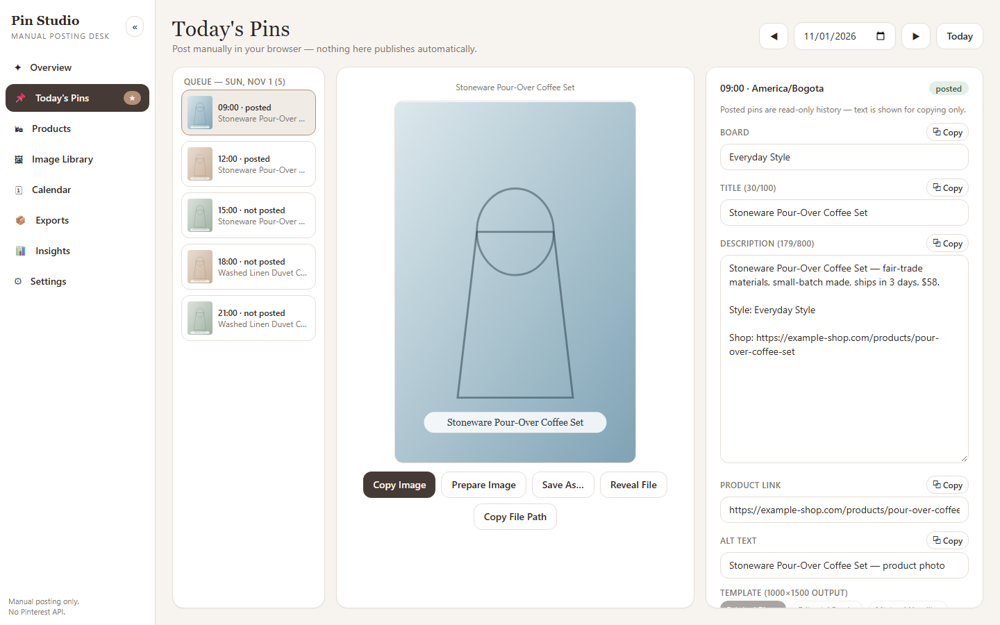
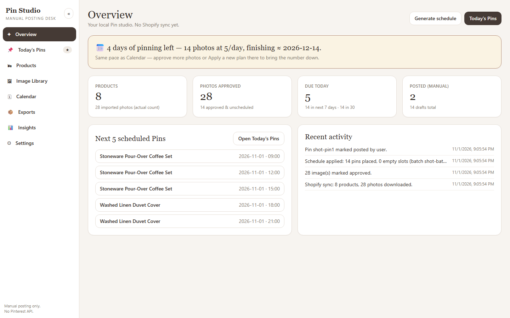
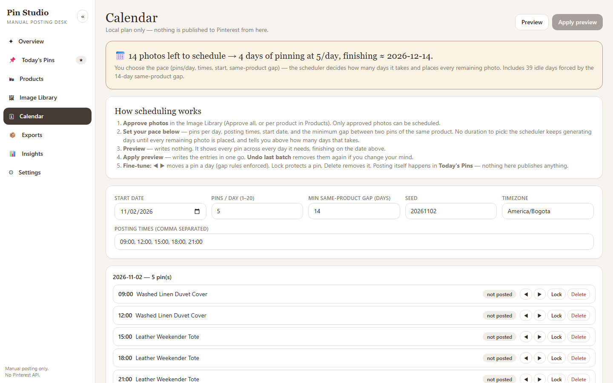
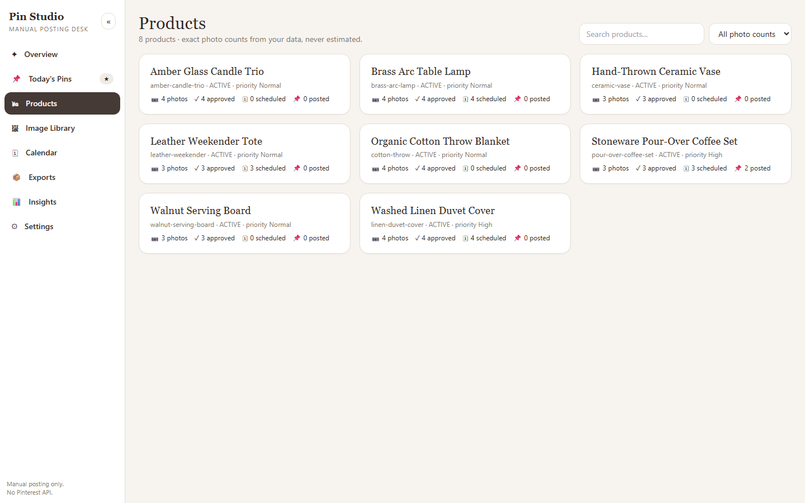
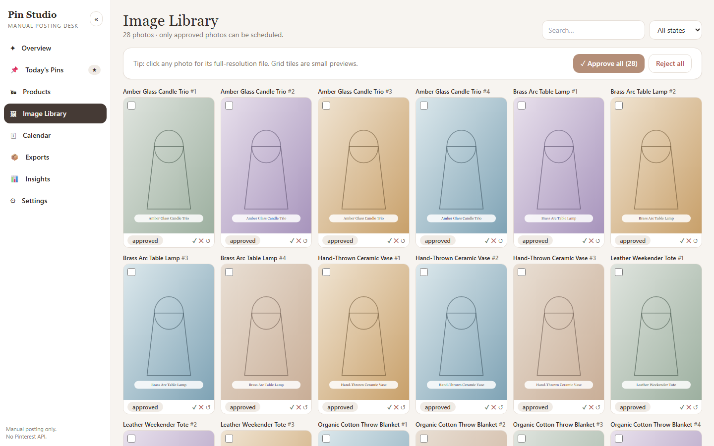
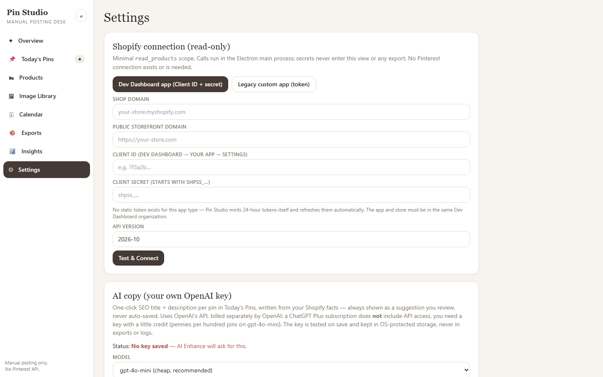

# Pin Studio

Your products, organized into a calm daily Pinterest posting ritual. Pin Studio imports every product and photo from your Shopify store (read-only), turns approved photos into a day-by-day Pinterest plan, and gives you a **Copy Desk** where each pin's image, title, description, link, and board name copies with one click — ready to paste into Pinterest by hand.

> **About these screenshots:** captured from the same React UI running in a browser preview, using fictional sample products — the installed desktop app looks identical. Clean captures, no watermarks.



**Today's Pins** is where you live every day: pick a pin in the queue, copy its image and text one field at a time, paste into Pinterest in your browser, then **Mark Posted**. Nothing here publishes automatically — it only records what *you* did.

## Screens

### Overview — how many pinning days you have left



The banner does the math for you (*"4 days of pinning left — 14 photos at 5/day, finishing ≈ …"*), from your real Calendar pace. Below: product/photo counts, due-today stats, the next 5 scheduled pins, and a log of your own activity (imports, approvals, postings — never Pinterest metrics).

### Calendar — the scheduler decides the length, you set the pace



Set pins/day, posting times, start date, and the minimum gap between two pins of the same product — then **Preview** generates as many days as it takes to place every remaining approved photo, and **Apply** writes it in one go. Gap-blocked days are counted as idle days, never silently filled. Locks protect pins, ◀ ▶ moves them (gap rules enforced), and **Undo last batch** reverses an Apply.

### Products — exact counts, never estimated



Every product with exact photo counts (approved / scheduled / posted), search, photo-count filters, priority, include/exclude from planning, and a per-product photo drawer with **Approve all**.

### Image Library — approve in bulk, inspect in full resolution



**Approve all** (with filters) or pick photos individually. Grid tiles are small previews — click any photo for its full-resolution file. Only approved photos can be scheduled.

### Settings — Shopify, AI copy, import, boards, backup, reset



Everything lives here: Shopify connection (Dev Dashboard app or legacy token, read-only), optional AI copy key, folder import without Shopify, local boards, image output, backup/restore, and the guarded **reset library** (keeps login + settings, deletes products/photos/pins/history only after typing RESET + checkbox + confirmation).

## Features

- **Shopify read-only sync** — all products + all images per product (cursor pagination, no 10-image cap), retrying downloads, stable identifiers; approvals, edits, calendar, and posting history survive re-syncs.
- **Boards from your collections** — sync creates local boards from your Shopify collection titles (generic catch-alls like *New Arrivals*, *Featured*, *Frontpage*, *Home page*, *All products* are skipped), points each product at its first collection's board, and never overwrites your manual picks.
- **Fair auto-scheduler** — each photo used once, same-product gap enforced against past + future + new entries, fair rotation across products, locked pins untouched, shortages explained instead of violated.
- **Copy Desk** — per-pin Copy Image (real OS bitmap), Copy Title / Description / Link / Board, Save As, Reveal File, Open Pinterest, posting packet, checklist, keyboard shortcuts (1/2/3/4/5/N).
- **Manual posting only** — copying, exporting, or opening Pinterest never marks anything posted. Only your explicit **Mark Posted** does (with optional Pinterest URL + notes, undoable).
- **Pin editor** — 1000×1500 renders, editable title/description/link/board/alt text/template, optional **AI Enhance** (your own OpenAI key, shown as a suggestion, never auto-saved).
- **Exports** — daily/weekly/custom posting packs (renders + CSV manifest + HTML sheet).
- **Local-first** — SQLite + files in your OS app-data folder, 7 rolling backups, reset that keeps credentials.

## Getting started

### Install & run (development)

```bash
npm install
npm run dev        # Vite renderer + Electron
```

Other useful commands: `npm run typecheck`, `npm run lint`, `npm test`, `npm run build`.

### Use the installed app

1. Install `release/Pin-Studio-Setup-1.0.0.exe` (Windows NSIS installer — **uninstall any previous Pin Studio build first** if upgrading).
2. The app opens **maximized** by default (normal Windows buttons — resize or un-maximize freely). Your data lives in `%APPDATA%/Pin Studio` (SQLite + originals/thumbs/renders/exports/backups), **outside** the install directory, so reinstalls keep everything.

### Connect Shopify (read-only)

In **Settings → Shopify connection**:

- **Dev Dashboard app (recommended):** enter your `your-store.myshopify.com` shop domain, public storefront domain (e.g. `https://your-store.com`), Client ID, and client secret (starts with `shpss_…`). Pin Studio mints and auto-refreshes 24-hour tokens itself — no static token to manage.
- **Legacy custom app:** enter the shop domain plus an Admin API access token (`shpat_…`) with `read_products` scope only.

3. **Sync now**. The app pages through **all** products and **all** media per product (cursor pagination, verified to 260+ products and 265 images on one product — no 10-image cap), downloads originals with retry, and preserves your approvals, edits, calendar, and posted history across re-syncs. Removed/unavailable photos are flagged `Needs review`, never silently deleted. Sync also **creates local boards from your Shopify collection titles** (no duplicates on re-sync) and points each product at its first collection's board — your manual board picks are never overwritten, and new pins inherit the product's board.

### First-run checklist

1. Settings → Shopify → Sync (or Folder import if you have no Shopify store).
2. Image Library → Approve all (or approve per product in Products).
3. Calendar → Preview → Apply to generate your posting plan.
4. Today's Pins: copy image + text, paste into Pinterest, Mark Posted.

### AI copy (optional, your own OpenAI key)

In **Settings → AI copy**, save an OpenAI API key (created at platform.openai.com → API keys, starts with `sk-`). Then **✨ AI Enhance** on any pin drafts an SEO title + description from your Shopify facts — always shown as a suggestion you review, never auto-saved. Billing is through OpenAI (pennies per hundred pins on `gpt-4o-mini`); a ChatGPT Plus subscription alone is **not** enough. The key is tested on save and kept in OS-protected storage.

## Data & safety

- SQLite (`pinstudio.db`) + originals/thumbs/renders/exports/backups live in the OS app-data folder (`%APPDATA%/Pin Studio` on Windows), **outside** the install directory, so reinstalls keep your data.
- Upgrading from the old Bellanera build? Uninstall it first, then install this build; if your data doesn't appear, copy `pinstudio.db`… (legacy `bellanera.db`) from the old app-data folder into the new one while the app is closed.
- Manual posting only: no Pinterest API, OAuth, auto-publishing, analytics, or browser automation. You open Pinterest yourself; the app just makes copying effortless.
- Backups: **Settings → Create backup**; restore by replacing `pinstudio.db` with the backup copy while the app is closed.
- Reset: **Settings → Danger zone** requires typing RESET + checkbox + final confirmation; it deletes products/photos/pins/schedule/history/files but keeps your Shopify connection, credentials, and settings.

## Packaging (Windows installer)

Built and verified on Windows 11 with `npm run package:win` → `release/Pin-Studio-Setup-1.0.0.exe` (NSIS, per-user, Start Menu + Desktop shortcuts).

- Native modules (`better-sqlite3`, `sharp`) are rebuilt for Electron automatically via `postinstall`/`@electron/rebuild`.
- If your environment can't run the packaging step, on a Windows PC run: `npm install`, then `npm run package:win`.

## Verification (this workspace)

- `npm run typecheck` — clean (renderer + main).
- `npm run lint` — clean.
- `npm test` — **46/46 pass** (scheduler auto-length + idle days + gap rules, board sync with generic blocklist, pagination, textgen, catalog bulk/reset/upsert, images, files, AI copy parsing).
- Installer rebuilt after the rename: `release/Pin-Studio-Setup-1.0.0.exe`.
- Screenshots above re-captured after the generalization (sample products, browser preview) and the temporary seed code fully reverted — verified zero `TEMP-SCREENSHOTS`/`shotsMode` traces remain in `src/`.

## Project layout

- `src/main/` — Electron main process: SQLite store, Shopify client, media sync, scheduler apply, image rendering, exports, backup, IPC.
- `src/renderer/` — React UI: Overview, Today's Pins, Products, Image Library, Calendar, Exports, Insights, Settings (+ dev-only `mockBridge` for browser preview).
- `src/shared/` — scheduler, text generation, types (used by both sides + tests).
- `tests/` — vitest suite. `docs/` — product spec, posting-desk UX, Shopify setup, test plan. `fixtures/` — offline demo catalog shape.
